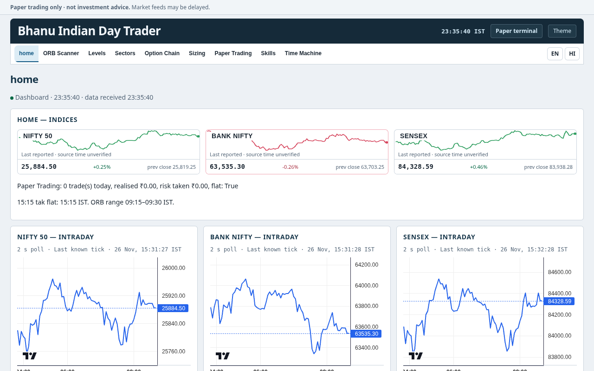
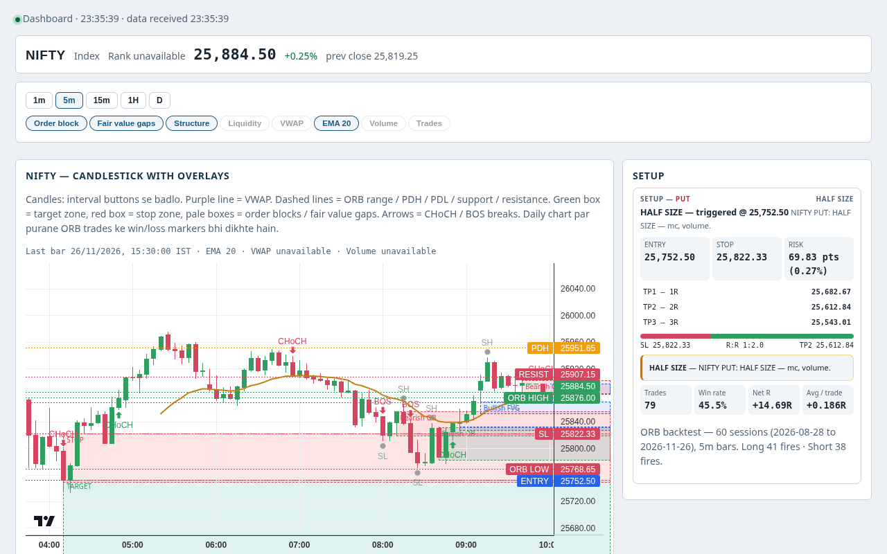
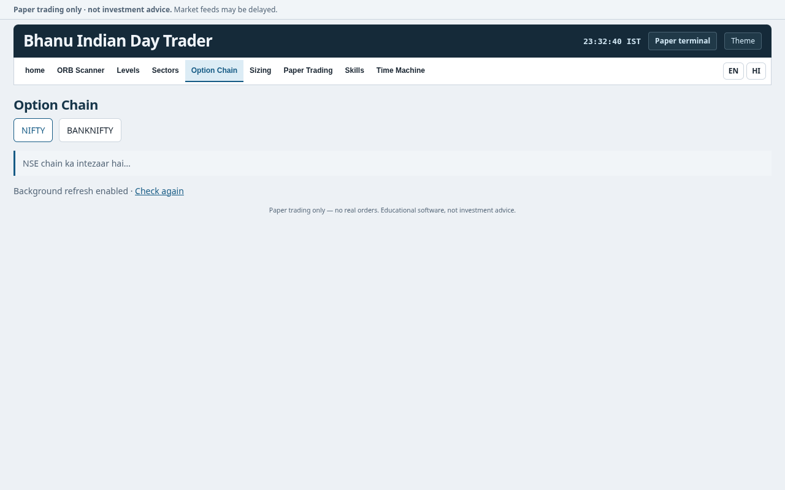
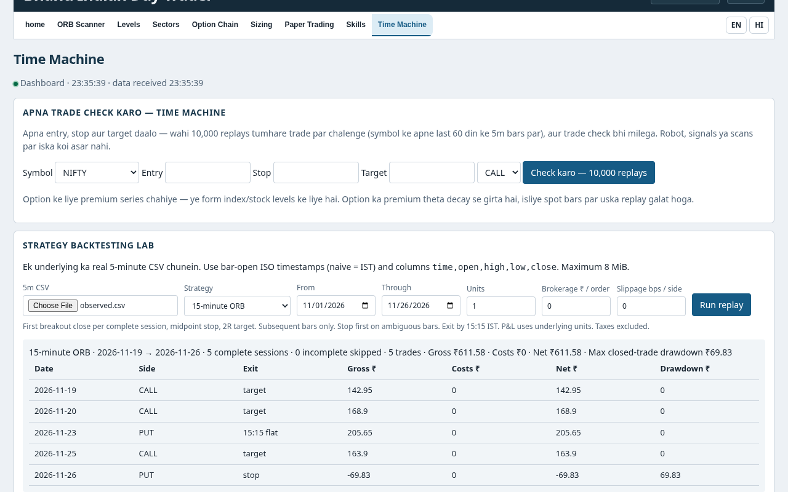
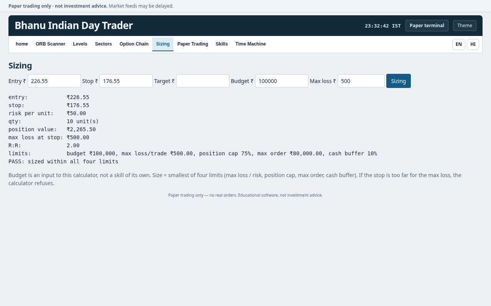
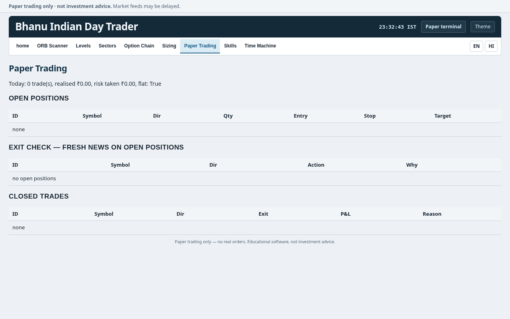

<!-- README.md -->
# Bhanu Indian Day Trader 🇮🇳

**An Indian market terminal for paper trading.** Follow NIFTY, BANK NIFTY and SENSEX, inspect a CALL/PUT setup, size the position and replay it before recording a paper trade. Hindi me samjho, English me trade karo.

[](https://github.com/indiandaytrader/Bhanu-Indian-Day-Trader/actions/workflows/tests.yml)
[Live demo](https://bhanu-indian-day-trader.onrender.com)

## Open the terminal

1. Install **Python 3.11+** and extract the release ZIP.
2. Double-click **Start-Windows.bat** on Windows or **Start-Mac.command** on macOS. The launcher installs the existing requirements locally, starts the service and opens your browser. On Linux, run `python3 start_dashboard.py` from the project folder.
3. The dashboard opens at **[localhost:8810](http://localhost:8810)**. First installation needs internet access. Leave the terminal window open during use.

If macOS strips execute permission after extraction, run `bash Start-Mac.command`. To run from source:

```bash
git clone https://github.com/indiandaytrader/Bhanu-Indian-Day-Trader.git
cd Bhanu-Indian-Day-Trader
bash run.sh
```

## Dashboard tour

These screenshots show the running dashboard. The two-second index poll can return an old price or an error. Check source times and feed notices. Screenshots are historical views.

| Market overview | Stock detail |
|---|---|
| [](docs/screenshots/overview.png) | [](docs/screenshots/stock.png) |
| **Option chain** | **Strategy Backtesting Lab** |
| [](docs/screenshots/chain.png) | [](docs/screenshots/lab.png) |
| **Sizing calculator** | **Paper ledger** |
| [](docs/screenshots/sizing.png) | [](docs/screenshots/paper.png) |

| Open | Use it for |
|---|---|
| `/`, `/sectors` | Index quotes, market flow, sector comparison and news |
| `/orb`, `/levels`, `/stock?symbol=NIFTY` | Completed-close breakouts, support/resistance, candles, VWAP, EMA and structure |
| `/chain` | Background option-chain snapshots, expiry-specific OI, PCR, max pain and Greeks |
| `/sizing`, `/paper` | Position limits, risk and the local paper ledger |
| `/timemachine` | 10,000 Monte Carlo replays, custom setup checks and historical strategy tests |
| `/skills` | Workflow status and coverage |

[Configure Telegram alerts](docs/guides/alerts.md) · [Use the strategy lab](docs/guides/lab.md) · [Configure the read-only broker fallback](docs/guides/broker.md)

## Deploy

[](https://render.com/deploy?repo=https://github.com/indiandaytrader/Bhanu-Indian-Day-Trader)

[](https://railway.com/new)

**Railway requires repository selection.** Choose **Deploy from GitHub repo** and select [indiandaytrader/Bhanu-Indian-Day-Trader](https://github.com/indiandaytrader/Bhanu-Indian-Day-ader). No Railway template has been published. Use one instance per ledger, mount persistent storage at `/app/data` and keep private paper ledgers access-controlled. Live demo: https://bhanu-indian-day-trader.onrender.com

## Tests

GitHub Actions runs `pytest -q` on Python 3.11 for pushes and pull requests to `main`. The badge links to the workflow history. To run locally after installing the requirements:

```bash
python -m unittest discover -s tests
```

Runtime dependencies remain pandas, NumPy and tzdata. The HTTP server, strategy replay and alert logic use Python’s standard library. Paper trading only. Educational software.
